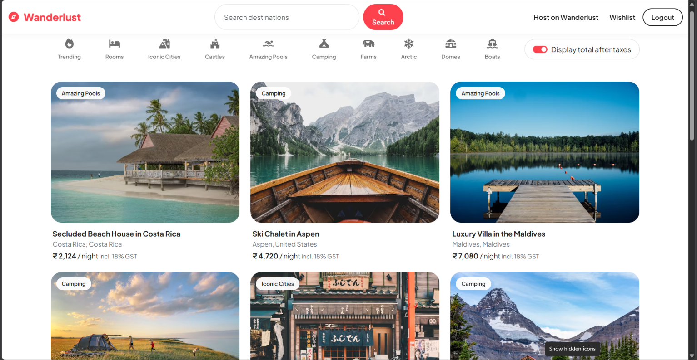
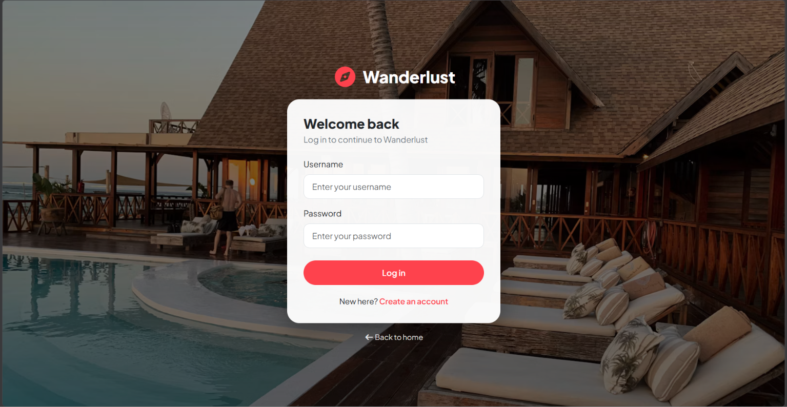
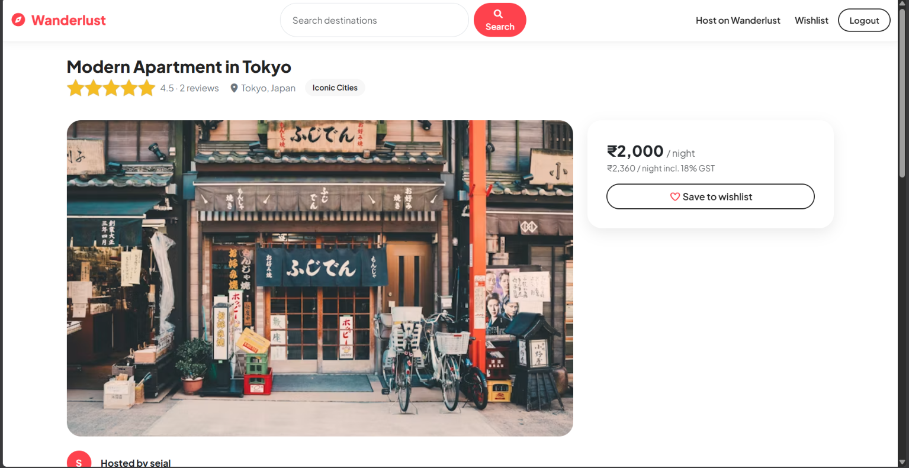
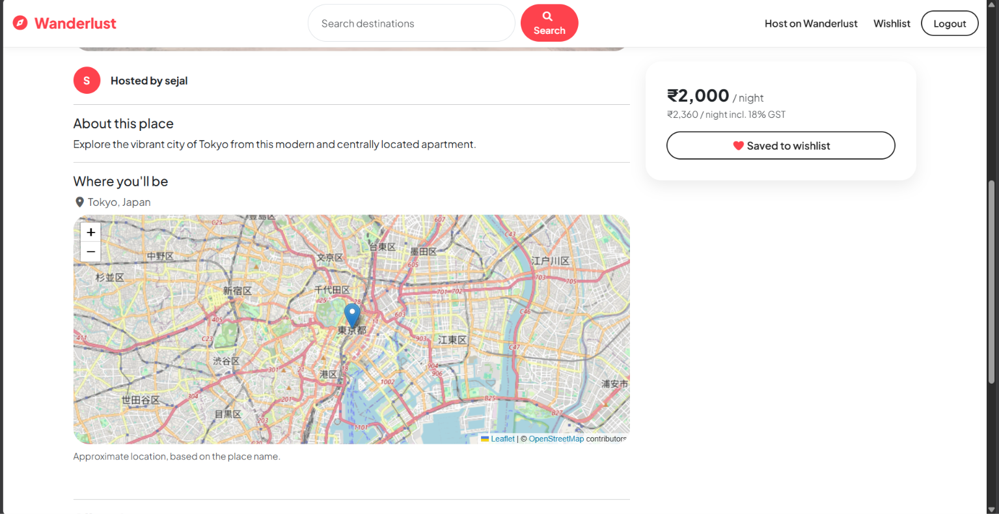
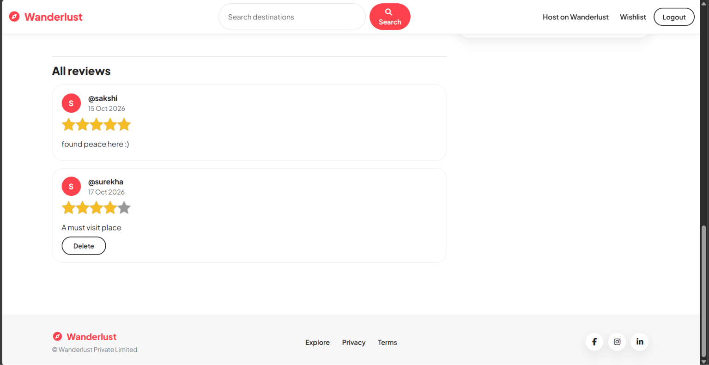
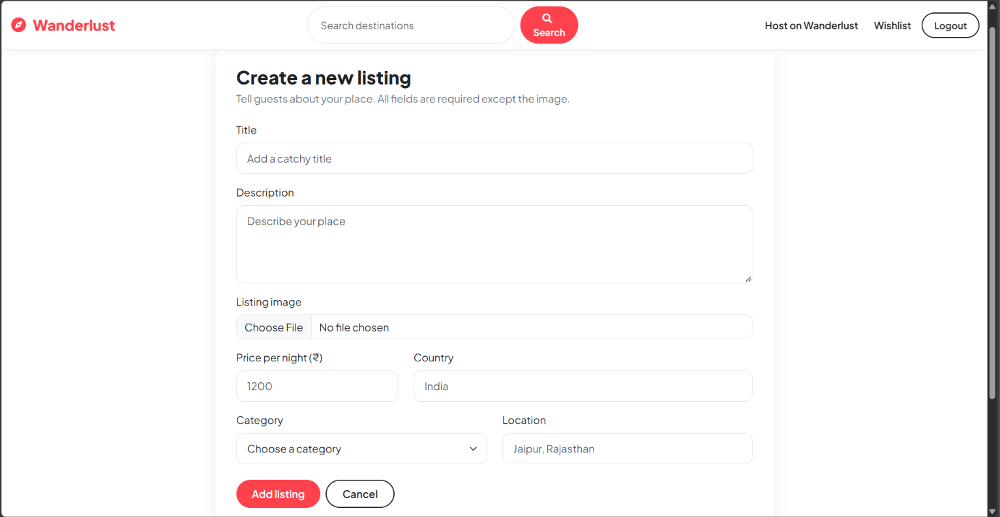
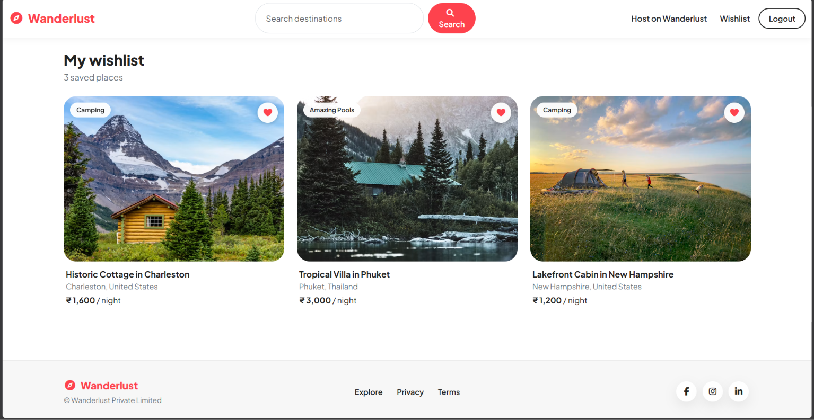

# Wanderlust

Wanderlust is a full-stack web app where travellers can discover places to stay and hosts can list their own. Browse listings on a map, search and filter by category, save favourites to a wishlist, and read or leave reviews.



---

## Screenshots

### Cover page


### Login


### Browse, search and filter
Search by title, location or country, filter by category, and switch prices to include 18% GST.


### Listing details with map
Photo, host, price card, average rating, reviews and an interactive map of the location.



### Map of a listing
Every listing on the current page, pinned on one map.



### Reviews of a listing


### Create a listing


### Wishlist


---

## Features

**For guests**
- Browse listings with pagination (12 per page)
- Search by title, location or country
- Filter by category (Trending, Rooms, Iconic Cities, Castles, Amazing Pools, Camping, Farms, Arctic, Domes, Boats)
- Toggle prices to show the total including 18% GST
- Listing page with photo, host, average star rating, reviews and a location map
- Map of all listings on the current page
- Save listings to a wishlist and remove them again

**For hosts**
- Create, edit and delete listings
- Image upload to Cloudinary, with a live preview before uploading
- Location is converted to map coordinates automatically
- Only the owner can edit or delete a listing
- Old images are deleted from Cloudinary when replaced or removed

**Accounts and reviews**
- Sign up, log in and log out, with sessions stored in MongoDB
- Protected routes that return you to the page you wanted after logging in
- One review per user per listing, and owners cannot review their own listing
- Only a review's author can delete it

**Experience**
- Responsive layout built with Bootstrap 5
- Cover page, custom 404 and error pages, privacy and terms pages
- Flash messages that disappear on their own

---

## Tech stack

| Area | Tools |
|---|---|
| Server | Node.js, Express |
| Database | MongoDB, Mongoose |
| Views | EJS, ejs-mate (layouts and partials) |
| Styling | Bootstrap 5, Font Awesome, custom CSS |
| Authentication | Passport (local strategy), passport-local-mongoose, express-session, connect-mongo |
| Validation | Joi (server side), Bootstrap validation (client side) |
| File uploads | Multer, Cloudinary |
| Maps | Leaflet, OpenStreetMap tiles, Nominatim geocoding |
| Security | Helmet (with a custom Content-Security-Policy), express-rate-limit, express-mongo-sanitize |
| Other | connect-flash, method-override, dotenv |

---

## Project structure

```
AIRBNB/
├── app.js               app setup, middleware, routes, error handling
├── cloudConfig.js       Cloudinary and Multer storage config
├── middleware.js        isLoggedIn, isOwner, isReviewAuthor, validators
├── schema.js            Joi validation schemas
├── models/              listing.js, review.js, user.js
├── controllers/         listings.js, reviews.js, users.js
├── routes/              listing.js, review.js, user.js
├── utils/               wrapAsync.js, ExpressError.js, categories.js, geocode.js
├── views/
│   ├── layouts/         boilerplate.ejs, auth.ejs
│   ├── includes/        navbar.ejs, footer.ejs, flash.ejs
│   ├── listings/        index, show, new, edit
│   ├── users/           login, signup, wishlist
│   ├── static/          privacy, terms
│   ├── landing.ejs      cover page
│   ├── 404.ejs
│   └── error.ejs
├── public/              css/, js/, favicon.svg
├── init/                data.js, index.js, addCategories.js, addGeometry.js
└── screenshots/         images used in this README
```

The app follows an MVC structure. Routes decide which middleware and controller handle a URL, controllers hold the logic, models define the data, and EJS templates render the pages.

---

## Data models

- **Listing:** title, description, image `{url, filename}`, price, location, country, category, geometry (GeoJSON point), reviews (references), owner (reference)
- **Review:** comment, rating (1 to 5), createdAt, author (reference)
- **User:** username, email, hashed password, wishlist (references to listings)

Reviews are stored as references and not embedded, because a listing can collect any number of them. Deleting a listing also deletes its reviews.

---

## Routes

| Method | Path | Access | Purpose |
|---|---|---|---|
| GET | `/` | Public | Cover page (logged-in users go to `/listings`) |
| GET | `/listings` | Public | Browse, search (`q`), filter (`category`), paginate (`page`) |
| GET | `/listings/new` | Logged in | New listing form |
| POST | `/listings` | Logged in | Create a listing |
| GET | `/listings/:id` | Public | Listing details |
| GET | `/listings/:id/edit` | Owner | Edit form |
| PUT | `/listings/:id` | Owner | Update a listing |
| DELETE | `/listings/:id` | Owner | Delete a listing |
| POST | `/listings/:id/wishlist` | Logged in | Save or remove from wishlist |
| POST | `/listings/:id/reviews` | Logged in | Add a review |
| DELETE | `/listings/:id/reviews/:reviewId` | Review author | Delete a review |
| GET, POST | `/signup`, `/login` | Public | Create an account, log in |
| POST | `/logout` | Logged in | Log out |
| GET | `/wishlist` | Logged in | Saved listings |
| GET | `/privacy`, `/terms` | Public | Static pages |

---

## Security

- Passwords are salted and hashed, never stored in plain text
- Session cookies are `httpOnly`, and sessions are stored in MongoDB
- Authorization is checked on the server for every write
- Input is validated with Joi and sanitized against NoSQL injection
- Search input is regex-escaped
- Helmet sets security headers, with a Content-Security-Policy limited to the sources the site uses
- Login and signup are rate limited, and the whole site has a general limit
- Logout uses POST, so another site cannot log users out
- Secrets live in `.env`, which is excluded from Git
- Detailed error messages are hidden in production

---

## Getting started

### Prerequisites

- [Node.js](https://nodejs.org/) 18 or newer
- [MongoDB](https://www.mongodb.com/try/download/community) running locally
- A free [Cloudinary](https://cloudinary.com/) account for image uploads

### Installation

1. Clone the repository and install the dependencies:

   ```bash
   git clone https://github.com/YOUR-GITHUB-USERNAME/YOUR-REPO-NAME.git
   cd YOUR-REPO-NAME
   npm install
   ```

2. Create a `.env` file in the project root:

   ```
   CLOUD_NAME=your_cloudinary_cloud_name
   CLOUD_API_KEY=your_cloudinary_api_key
   CLOUD_API_SECRET=your_cloudinary_api_secret
   SECRET=a_long_random_string
   ```

3. Make sure MongoDB is running at `mongodb://127.0.0.1:27017`. The `wanderlust` database is created automatically.

4. Start the app:

   ```bash
   node app.js
   ```

5. Open [http://localhost:8080](http://localhost:8080).

### Environment variables

| Variable | Purpose |
|---|---|
| `CLOUD_NAME` | Cloudinary cloud name |
| `CLOUD_API_KEY` | Cloudinary API key |
| `CLOUD_API_SECRET` | Cloudinary API secret |
| `SECRET` | Secret used to sign session cookies |

### Optional: load sample data

1. Run the app, sign up, and copy your user's `_id` from the `users` collection.
2. In `init/index.js`, replace the hardcoded `owner` ID with yours.
3. Run the scripts from the project root:

   ```bash
   node init/index.js          # replaces all listings with the sample listings
   node init/addCategories.js  # assigns a category to listings that have none
   node init/addGeometry.js    # adds map coordinates (takes about a minute)
   ```

`init/index.js` deletes every existing listing before inserting the samples, so don't run it on data you want to keep. `addGeometry.js` pauses between requests to respect the Nominatim usage limit of about one request per second.

---

## What I learned

- Structuring an Express app with MVC, routers, controllers and reusable middleware
- Session-based authentication and authorization with Passport
- Modelling one-to-many and many-to-many relationships in MongoDB, and using `populate`
- Handling multipart uploads and storing images on Cloudinary
- Why middleware order matters (for example Multer before validation)
- Securing an app with Helmet and a Content-Security-Policy, rate limiting and input sanitization
- Geocoding place names and rendering maps with Leaflet, including the longitude/latitude order mismatch between GeoJSON and Leaflet
- Debugging real problems: async errors, session store setup, CSP blocks and cached assets

---

## Roadmap

- [ ] Booking system with date selection and total price
- [ ] Multiple images per listing with a gallery
- [ ] User profile page
- [ ] Marker clustering for listings in the same place
- [ ] CSRF protection
- [ ] Automated tests (Jest and Supertest)
- [ ] Deployment with MongoDB Atlas, with the database URL moved into an environment variable

---

## Acknowledgements

- Map data &copy; [OpenStreetMap](https://www.openstreetmap.org/copyright) contributors, with maps drawn by [Leaflet](https://leafletjs.com/) and addresses looked up with [Nominatim](https://nominatim.org/)
- Icons by [Font Awesome](https://fontawesome.com/) (Free, CC BY 4.0)
- Layout components by [Bootstrap](https://getbootstrap.com/)
- Image hosting by [Cloudinary](https://cloudinary.com/), and sample listing photos from [Unsplash](https://unsplash.com/)

---

